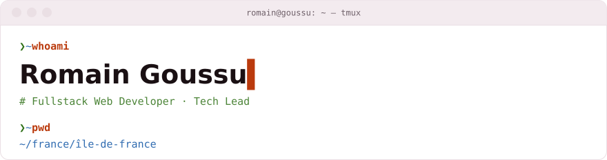
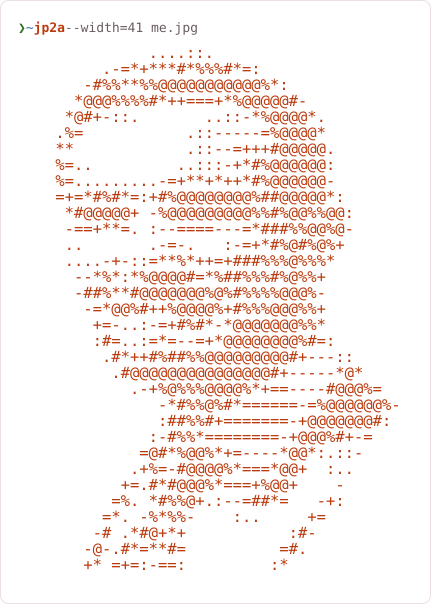

<!-- GENERATED by Alfred (cv-site/src/profile-readme.ts) from cv/en/*.md — do not edit by hand. -->
<picture>
  <source media="(prefers-color-scheme: dark)" srcset="assets/hero-dark.svg">
  
</picture>

<table>
<tr>
<td width="46%" valign="top">

<picture>
  <source media="(prefers-color-scheme: dark)" srcset="assets/portrait-dark.svg">
  
</picture>

</td>
<td width="54%" valign="top">

### ❯ `cat summary.md`

Fullstack engineer and Tech Lead with ~10 years across software publishers, consultancies and
regulated sectors (finance, aviation, public services). I build and run microservice systems
(hexagonal architecture, event-driven, design-by-contract) on a Java/Quarkus & Node back end with
React/Angular front ends, and I lift teams through it — coaching, testing culture, CI/CD, and
pragmatic cloud (AWS, Terraform). Equally at home extracting shared services from a monolith and
mentoring engineers toward the state of the art.

### ❯ `ls ~/skills`

- **Back-end** — Java (8 → 21), Spring / Spring Boot, Quarkus (MicroProfile), Node.js (Express, Inversify), PostgreSQL, MongoDB, ArangoDB / graph databases
- **Architecture & messaging** — Hexagonal architecture, Event-driven architecture, Design by contract, REST / gRPC, Kafka, RabbitMQ, Redis
- **DevOps / Infra** — AWS (Cognito, CloudFront, App Runner, DynamoDB, Route 53, ACM, IAM), Terraform, Docker, GitLab CI, Jenkins, Ansible, Git
- **Front-end** — React (Redux, MobX, Flux), Angular

### ❯ `ls ~/open-source`

- planks — authored & published an every-layout web-components library to npm (@rgoussu.dev/planks).

### ❯ `cat beyond-the-code.md`

- Tinkering with Claude, infra, Kubernetes and other software engineering.
- Chess, go and other board games; video games.
- Heavy reader — fan of Asimov, all things Tolkien.
- EVA (Esport Virtual Arena) — competing with the Craft and Conquer team in the Paname league.

### ❯ `ping romain`

[CV / website](https://rgoussu-dev.github.io/CV-And-Blog/cv/) · [GitHub](https://github.com/rgoussu-dev) · [planks (npm)](https://www.npmjs.com/package/@rgoussu.dev/planks) · rgoussu@gmail.com

</td>
</tr>
</table>

<picture>
  <source media="(prefers-color-scheme: dark)" srcset="assets/tmux-dark.svg">
  
</picture>
